  <picture>
    <source media="(prefers-color-scheme: dark)" srcset="assets/banner-dark.v9.svg">
    <source media="(prefers-color-scheme: light)" srcset="assets/banner-light.v9.svg">
    
  </picture>

# Jonathan Joel Contreras Villafuerte
### Estudiante de Gestión de Tecnologías de la Información | Desarrollador Java & Python

*"Creo que la tecnología debe servir a las personas, no al revés. Mi objetivo es crear soluciones técnicas con sentido humano."*

### 👨‍💻 Sobre Mí

- 🎓 Cursando el 3er año de la **Licenciatura en Gestión de Tecnologías de la Información (Sistemas)** en **UADE**.
- 🛠️ Experiencia práctica desarrollando aplicaciones de escritorio y backend en **Java** y scripts de automatización en **Python**.
- 🐧 Certificado en **Red Hat System Administration I**, con manejo de entornos Linux y contenedorización con **Docker**.
- 🗄️ Trabajo con arquitectura de datos relacionales (SQL Server, SQLite) y modelado NoSQL.
- 🎯 Enfoque en optimización de procesos de negocio, soporte de infraestructura TI y digitalización empresarial.

---

### 🛠️ Tech Stack & Herramientas

#### **Lenguajes y Backend**

#### **Infraestructura, DevOps & Sistemas**

#### **Bases de Datos & Herramientas**

---

### 📊 Estadísticas & Competencias

  <picture>
    <source media="(prefers-color-scheme: dark)" srcset="assets/radar-dark.svg">
    <source media="(prefers-color-scheme: light)" srcset="assets/radar-light.svg">
    
  </picture>
  <picture>
    <source media="(prefers-color-scheme: dark)" srcset="assets/radar-langs-dark.svg">
    <source media="(prefers-color-scheme: light)" srcset="assets/radar-langs-light.svg">
    
  </picture>

---

### 🚀 Proyectos Destacados

- **Sistema de Gestión de Pedidos & Stock**: Aplicación de escritorio desarrollada en **Java (Swing)** y base de datos relacional para optimización operativa en comercio minorista.
- **Plataforma E-commerce Web**: Tienda online de telefonía desarrollada aplicando estándares de **HTML5, CSS3 y JavaScript**, priorizando diseño adaptable y experiencia de usuario.
- **Automatización de Archivos**: Scripts en **Python** para procesamiento y organización automática en sistemas locales.

---

### 📬 Conectemos

- 💼 **LinkedIn**: [jonathan-joel-contreras-villafuerte](https://www.linkedin.com/in/jonathan-joel-contreras-villafuerte/)
- 📧 **Correo**: [joelcontreras.ar@gmail.com](mailto:joelcontreras.ar@gmail.com)
